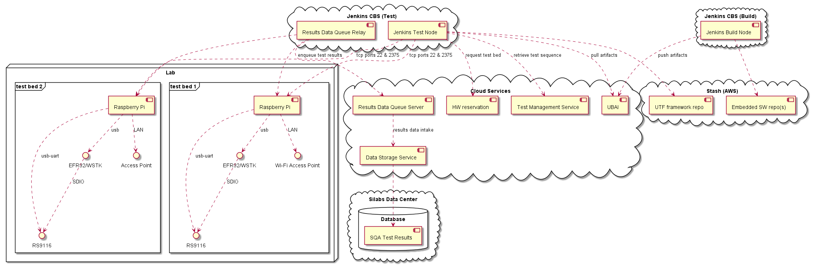

# UTF WiSeConnect SQA Application

# Overview

# Submodules Included
[UTF Core Submodule](docs/UTFCore.md)

[UTF Extension Submodules](docs/UTFExtensions.md)

[Toolchain Manager](docs/TCMGR.md)

# Getting Started
[Creating](docs/ProjectCreation.md) a new UTF top-level application based on this template.

Initial [Workspace Setup](docs/WorkspaceSetup.md).

[Configuration and Customization](docs/Configuration.md).

# Digging Deeper
[Developing Tests](docs/TestDevelopment.md).

[Running Tests](docs/RunningTests.md).

[HWMux Integration](docs/HWMuxIntegration.md): use the HWMux to store test bed configurations and reserve test hardware

# Contributing
[Extending UTF](docs/UTFExtensions.md) to support new devices & communication protocols.

# Links
Get [links](docs/Links.md) to upstream documentation and learning resources.

# FAQ
Read the [FAQ](https://confluence.silabs.com/display/UTF/FAQ)