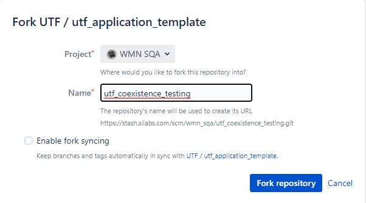

# UTF Project Creation

To create a new UTF project, just [fork](https://stash.silabs.com/projects/IOT_INFRA_SW/repos/utf_stack_template?fork) this repo into a new repo within an appropriate stash project for your team.
No need to check "Enable fork syncing" since it will likely be unnecessary to pull further changes from the template repo.

Don't forget to change the repo name to something more appropriate for the end application.

